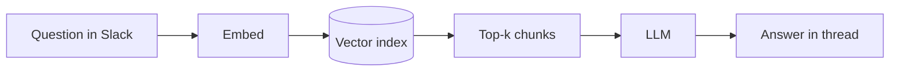

Everything below is plain markdown — the same thing you'd type into a GitHub issue. Open this file (`content/styleguide.md`) next to the rendered page to see the source for each feature.

## Text

Paragraphs, **bold**, _italic_, ~~strikethrough~~, `inline code`, and [links](https://github.com). Inline code can be highlighted too: `const x: number = 42{:ts}`. Emoji shortcodes work :rocket: :tada:. Keys: <kbd>⌘</kbd> + <kbd>K</kbd>.

GitHub references are linked automatically: #3, @nnamanikester.

### Lists

- Unordered lists
- With nesting
  - like this
- [x] and task lists
- [ ] that render as checkboxes

1. Ordered lists
2. Use mono numerals

> A plain blockquote, for when someone else said it better.

## Alerts

> [!NOTE]
> Useful information the reader should notice even when skimming.

> [!TIP]
> Helpful advice for doing things better.

> [!IMPORTANT]
> Key information needed to succeed.

> [!WARNING]
> Urgent information that needs immediate attention.

> [!CAUTION]
> Negative consequences of an action.

## Code

A fenced block with a language gets a header with the language name, a copy button, and a wrap toggle. Add `title="…"` for a filename, `showLineNumbers` for numbers, and `{1,3-4}` to highlight lines.

```ts title="lib/retry.ts" showLineNumbers {3,7-9}
export async function retry<T>(fn: () => Promise<T>, attempts = 3): Promise<T> {
  let lastError: unknown;
  for (let i = 0; i < attempts; i++) {
    try {
      return await fn();
    } catch (err) {
      lastError = err;
      await new Promise((r) => setTimeout(r, 2 ** i * 100));
    }
  }
  throw lastError;
}
```

Highlight words with `/word/` in the meta:

```py /chunk/
def split(source: str, size: int = 512) -> list[str]:
    chunk = []
    return [source[i : i + size] for i in range(0, len(source), size)]
```

Inline notation comments for diffs, focus, highlights and errors:

```tsx title="Button.tsx"
export function Button({ label }: Props) {
  const color = "gray"; // [!code --]
  const color = useTheme().accent; // [!code ++]
  return <button style={{ color }}>{label}</button>; // [!code highlight]
}
```

```js
const res = await fetch("/api/posts"); // [!code focus]
const posts = await res.json(); // [!code focus]
console.log(posts.length);
```

```js
const unused = 1; // [!code warning]
JSON.parse("{"); // [!code error]
```

### Tabs

Group blocks with `:::code-group`. The reader's choice is remembered across every group on the site.

:::code-group
```ts title="TypeScript"
const sum = (a: number, b: number): number => a + b;
```

```py title="Python"
def sum(a: int, b: int) -> int:
    return a + b
```

```go title="Go"
func Sum(a, b int) int { return a + b }
```
:::

Shell blocks tagged `npm2yarn` become npm / pnpm / yarn / bun tabs automatically:

```sh npm2yarn
npm install -D vitest
```

Long blocks (over 28 lines) collapse with a "show all" button.

## Tables

| Approach        | Quality | Speed | Notes                          |
| --------------- | :-----: | ----: | ------------------------------ |
| By file         |   Low   |  Fast | Chunks too big for context     |
| Fixed tokens    |   Mid   |  Fast | Splits functions mid-way       |
| AST (tree-sitter) |  High  |  Slow | Best boundaries, more code     |

## Maths

Inline $E = mc^2$ and display:

$$
\text{softmax}(x_i) = \frac{e^{x_i}}{\sum_{j} e^{x_j}}
$$

## Diagrams



## Media


Embeds — a YouTube or X link alone on a line, or the swyxkit shortcodes:



## Details and footnotes

<details>
<summary>Raw HTML works in posts</summary>

So you can fold long asides away, with **markdown** inside.

</details>

Footnotes are collected at the bottom[^1], with links back[^why].

[^1]: Like this one.
[^why]: GitHub-flavoured markdown supports them natively.
